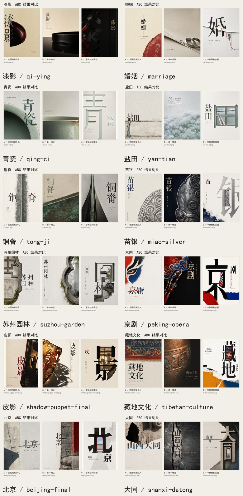

# 东方文化编辑海报

> **即梦版已提供：** [下载即梦技能 ZIP](https://github.com/dacnay816y62-hub/fantasy-dongfang-jianyuehaibao/releases/download/jimeng-v1.0.0/fantasy-dongfang-jianyuehaibao-jimeng-v1.0.0.zip) · [查看即梦版说明](jimeng/README.md)。上传即梦请使用此专用 ZIP；原版技能继续保留。


**FANTASY / 梵想美学 · 文化海报与编辑设计**

用真实文化物证、标题动作与留白建立东方编辑海报，支持文字创意与 A/B/C 成组比较。

**[快速开始](#start)** · **[下载与安装](#install)** · **[完整规则](SKILL.md)** · **[全部视觉 Skills](https://github.com/dacnay816y62-hub?tab=repositories)**



<a id="start"></a>

## 一分钟开始

| 你提供 | 这套 Skill 组织的交付 |
| --- | --- |
| 主题、短标题、文化材料或关键词组 | 完整海报版面；可按 A/B/C 三方向比较 |

```text
用 $oriental-editorial-poster 做一张「残荷」主题的 3:4 编辑海报。以一处真实材料细节承载主题，让短标题与图像发生关系，保留有作用的留白。
```

**生成说明：** Skill 组织设计判断、提示词与执行流程；图片由当前环境中可用的图像工具生成或编辑。示例用于理解视觉方向，具体来源以本仓库记录为准，不能据此保证每次得到相同效果。

<a id="install"></a>

## 下载与安装

**[下载当前分支 ZIP](https://github.com/dacnay816y62-hub/fantasy-dongfang-jianyuehaibao/archive/refs/heads/main.zip)** · **[阅读 Skill 规则](SKILL.md)**

1. 下载并解压仓库。
2. 将仓库根目录（包含 `SKILL.md`）放入当前助手支持的技能目录。
3. 安装文件夹命名为 **`oriental-editorial-poster`**，确保入口是 `oriental-editorial-poster/SKILL.md`。
4. 在支持技能调用的会话中使用 **`$oriental-editorial-poster`**。如果列表未刷新，新开一个任务。

Codex CLI / IDE 的用户级目录是 `~/.agents/skills/`，项目级目录是 `.agents/skills/`；Windows 用户目录可写为 `%USERPROFILE%\.agents\skills\`。以 [OpenAI 官方安装说明](https://learn.chatgpt.com/docs/build-skills#where-codex-loads-local-skills) 为准。ChatGPT 与其他宿主请按各自的技能加载方式使用。

仓库名与调用名可能不同，以上以 `SKILL.md` 中的名称为准。安装不包含图像服务、账户或生成额度；实际出图取决于你使用的环境。

---

## 适合做什么

- 中文文化主题海报、展览封面、出版物封面
- 文字创意极简风格测试
- 东方幻想、诗词、城市、器物、材料、人物、自然意象主题
- 1 到 6 个关键词的快速批量出图
- 需要“字和图互相改变”的标题视觉，而不是普通排版叠字

## 核心审美

- 一个强材料证据：石、纸、布、残叶、水线、器物边缘、建筑缝、光影等
- 一个标题动作：投影、裁切、反射、轮廓、局部遮挡、测量、镂空、压印等
- 一个清晰留白场：留白必须承担阅读、呼吸或结构作用
- 一个小型干扰器：线、点、色条、边界、水痕、线头或局部痕迹
- 中性色为主，只保留一个有效强调色
- 禁止伪小字、二维码、随机印章、旅游宣传感和无来源的装饰纹理

## v2 测试资产

Image 2 的公开测试素材放在 [`v2-tests/`](v2-tests/)。

精选 A/B/C 三联总览：


精选方向包括：漆影、婚姻、青瓷、盐田、铜脊、苗银、苏州园林、京剧、皮影、藏地文化、北京、大同。

`v2-tests/` 包含：

- `images/`: 原始 Image 2 PNG 出图
- `prompts/`: 对应 prompt 记录
- `selected-triptychs/`: 挑选后的 A/B/C 三联对比图
- `README.md`: 测试集说明和精选列表

## 目录结构

```text
oriental-editorial-poster/
├─ SKILL.md
├─ agents/
│  └─ openai.yaml
├─ assets/
│  └─ reference-layouts/
├─ examples/
├─ v2-tests/
│  ├─ images/
│  ├─ prompts/
│  └─ selected-triptychs/
└─ references/
   ├─ editorial-systems.md
   └─ fantasy-text-minimal.md
```

## 使用示例

```text
$oriental-editorial-poster
关键词：残荷
做一张文字创意极简海报，3:4 竖版。
```

```text
$oriental-editorial-poster
主题：李白
不要旅游海报感，不要大水墨。做成一本文学杂志封面，标题和月光/纸页/酒痕发生关系。
```

```text
$oriental-editorial-poster
关键词：琵琶、太湖石、大雁塔、北京、厦门、AI
每个主题各做一张，风格要分开，不要重复同一种大字构图。
```

## 示例图

示例图已单独放在 [`examples/`](examples/) 目录，不直接塞进首页 README。它们用于展示“文字创意极简 / 材料证据 / 编辑式封面”的方向，是风格样张，不是固定模板。

## 生成模式

这个 skill 默认要求使用图像生成作为生产步骤。

- **Mode A：直接图像海报**  
  适合短标题、幻想文字、强图文融合、单张创意测试。

- **Mode B：图像生成式海报版面**  
  适合更稳的出版物封面、多字标题、城市/文化/展览主题。整体仍由图像生成完成，包括标题位置、图像位置和版式层级；只是标题区更清楚、版式更像真实封面。

- **A/B/C 测试**  
  适合批量验证。A 是古图档案介入，B 是单一物证，C 是字体结构实验。每个题材三张成组评估，不按孤立单图判断。

如果当前 Codex 环境没有内置图像生成工具，也没有可用 API 后端，这个 skill 只能先产出高质量提示词和构图方案，不能假装已经出图。

## 重要文件

- `SKILL.md`  
  主工作流，定义触发条件、生产模式、构图门槛和最终质量检查。

- `references/editorial-systems.md`  
  编辑式海报的版式系统参考。

- `references/fantasy-text-minimal.md`  
  面向“文字创意极简”和用户筛选出的优秀样张整理出的审美覆盖层。

- `assets/reference-layouts/`  
  用于理解版式气质的参考图，不应被逐像素复制。

## 注意

- 本仓库不包含 API key、账号信息或图像生成额度。
- 参考图用于学习视觉语法，不代表可商用授权。
- `v2-tests/` 是公开测试资产和 prompt 记录，用于说明 v2 的审美收敛过程；正式项目素材仍建议单独保存。

## FANTASY / 梵想美学

**让想象先被看见。** 将视觉判断与创作流程整理成可以继续使用的方法。

**[浏览全部视觉 Skills](https://github.com/dacnay816y62-hub?tab=repositories)** · [Regional Culture Poster](https://github.com/dacnay816y62-hub/regional-culture-poster) · [FANTASY Minimal Magazine](https://github.com/dacnay816y62-hub/FANTASY-Minimal-Magazine)
